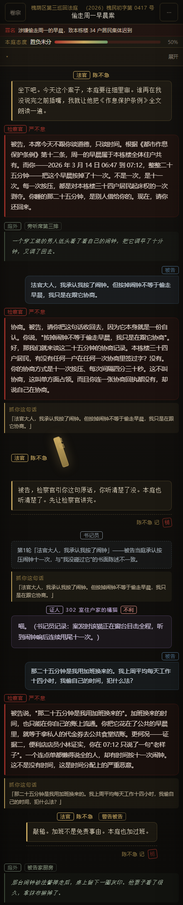
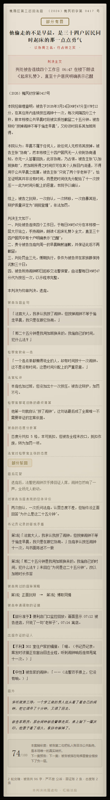

# 杠精法庭

一个荒诞法庭小游戏。你是被告，罪名很荒谬，程序很严肃。
AI 检察官会**逐字引用你刚说的话**来攻击你，AI 法官会插话、会偏心、会敲槌。

```
你：我承认我按了闹钟，但按掉闹钟不等于偷走早晨，我是在跟它协商。
检察官：协商。被告，请你把这句话收回去，因为它本身就是一份自认。
        你说「按掉闹钟不等于偷走早晨，我只是在跟它协商」……
        原告家路由器有没有在任何一次协商里签过字？没有。
```

判完全场会给你一份**判决书长图**，判词标题和判决主文可以直接当视频封面。

## 截图

| 庭审 | 判决书 |
|---|---|
|  |  |

---

## 跑起来

### 第 0 步：配一个 API key（**必须，否则法庭不会说话**）

代码里**没有、也不会有**任何 key —— 你得用自己的。最简单的方式：在 `game\` 目录下建一个
`.env` 文件，写一行：

```
DEEPSEEK_API_KEY=sk-你的key
```

key 去 <https://platform.deepseek.com> 注册拿。一局大约**几分钱**。

> 仓库的 `.gitignore` 已经挡了 `.env`，但仍请自己确认**别把它提交上去**。
> 想换模型、或者接自己的中转站，见 [密钥从哪来](#密钥从哪来) 和 [用哪个模型](#用哪个模型)。

### 然后三步

1. 双击项目根目录的 **`启动.cmd`**（自动找 Node、起服务、开浏览器）
2. 浏览器打开 **http://127.0.0.1:8790**
3. 选「普通程序」或「速审程序」→ 开庭 → 在输入框里打字辩护

> 想看界面但不想花 AI 额度：打开 **http://127.0.0.1:8790/?demo=1**
> 还能直接跳到指定一屏：`?demo=1&stage=trial` / `?demo=1&stage=verdict`

**环境要求**：Node.js **22 或更高**（用了内置 `fetch`）。**没有任何 npm 依赖**，
不需要 `npm install`。

## 两种程序

| | 普通程序 | 速审程序 |
|---|---|---|
| 发言次数 | 不限，辩到你自己喊休庭 | 5 句 |
| 节奏 | 你自己控 | 第 5 句后自动宣判 |
| 适合 | 玩得深、想把检察官逼急 | 录视频、做短视频，节奏天然好看 |

两种程序里检察官的攻击性都会**逐轮升级**：冷静程序化 → 不耐烦 → 暴躁 → 失控边缘。

## 发布到公网（长期可用）

### 出现 Error 1033 是什么意思

```
Error 1033 · Cloudflare Tunnel error
The host ... is configured as a Cloudflare Tunnel,
and Cloudflare is currently unable to resolve it.
```

**意思是：那条隧道进程已经死了**，所以主机名解析不到。不是网络问题，不是被墙，
重试几次也没用（Cloudflare 自己也是这么说的，但那句话对这种情况是误导）。

根因：**从聊天/终端会话里启动的进程，会随会话结束一起被杀掉。**
我早先给的 `发布到公网.cmd` 就是这个毛病——会话一结束，链接就废。

### 正确的装法：注册成计划任务

用**管理员身份**运行一次：

```powershell
powershell -NoProfile -ExecutionPolicy Bypass -File ".\register-service.ps1"
```

它装一个叫 `GangjingCourt` 的计划任务，指向 `serve-public.ps1`（supervisor），后者：
- 拉起游戏服务 + cloudflared 隧道
- 盯着两个进程，挂了自动重启
- 把当前公网链接写进 `public-url.txt`

触发器：**开机 · 登录 · 每 5 分钟兜底一次**。
计划任务归 Windows 管，**不随任何会话结束而死**——这才是"长期可用"。

### 看当前链接

```powershell
node ai-courtroom-game\game\show-url.mjs
```

它会打印链接、生成时间，并**实测这个链接是否真的还活着**（避免把失效链接发出去）。

### 日常管理

| 想做什么 | 命令 |
|---|---|
| 看链接 | `node game\show-url.mjs` |
| 看是否在跑 | `Get-ScheduledTask -TaskName GangjingCourt` |
| 停止对外 | `Stop-ScheduledTask -TaskName GangjingCourt` |
| 重新开始 | `Start-ScheduledTask -TaskName GangjingCourt` |
| 彻底卸载 | `Unregister-ScheduledTask -TaskName GangjingCourt -Confirm:$false` |
| 看日志 | `logs\supervisor.log`、`logs\server.err.log`、`logs\tunnel.err.log` |

### 这个方案的硬限制

| 限制 | 说明 | 能否解决 |
|---|---|---|
| **域名会变** | cloudflared 免费快速隧道每次重启换域名。`public-url.txt` 会重写，**旧链接失效** | 免费方案下不可避免 |
| **电脑必须开机** | 关机 / 睡眠 → 链接失效 | 换云服务器可以解决 |
| **无可用性保证** | 隧道是免费方案，不保证 uptime | 换具名隧道或云服务器 |

**想要固定域名**：需要一个自己的域名 + Cloudflare 账号，改用
`cloudflared tunnel create` 具名隧道（免费套餐支持，但不支持泛域名）。
本脚本用的是快速隧道，所以域名必然变。

### 公网防护：只留一道"防刷爆"

| 防护 | 默认 | 环境变量 | 说明 |
|---|---|---|---|
| 单 IP 限流 | **30 次/分钟** | `RATE_MAX_REQ` | **不是配额**，是防刷爆 |
| 默认深度思考档 | `off` | `THINK_LEVEL` | 新访客的初始值，玩家可以在首页自己改 |

**场次不限制。** 以前有一道「全站每天 300 场」的配额（`QUOTA_MAX_CALLS`），
已按需求去掉：`/api/health` 也不再返回 `used/max`，玩家界面上看不到任何额度数字。

保留单 IP 限流的原因不是"限制玩家"，而是**防止余额被刷光**：
正常玩家一局最多十几次调用，30 次/分钟碰不到；而一个死循环脚本会在第一分钟被挡住，
不会同时压几百个模型请求把服务打挂。想彻底关掉就把 `RATE_MAX_REQ` 设成很大的数。

改这些：编辑 `serve-tailscale.ps1` 顶部的 `$env:` 那几行，然后重启任务。

> 安全：`/api/health` 不泄露任何密钥/模型信息；**API key 从不下发给前端**。

### 备选：不想注册计划任务的临时用法

双击根目录的 `发布到公网.cmd`（或 `node game/tunnel.mjs`）——它前台起服务+隧道并把链接复制到剪贴板。
**但这个窗口一关链接就废**，只适合临时给人看一眼。

### 目测要换云平台的话

| 平台 | 能否用 | 障碍 |
|---|---|---|
| **Render** 免费 Web Service | ⚠️ 可以 | 闲置 15 分钟休眠，冷启 30–60 秒 |
| **Cloudflare Workers** | ❌ | 免费层每次调用只给 10ms CPU，而这里要跑 5–24 秒 |
| **Vercel Hobby** | ⚠️ 技术可行 | **条款禁止商用**，投稿活动踩线 |
| **Fly.io / Koyeb / Heroku** | ❌ | 免费额度均已取消 |
| **Railway** | ⚠️ | 一次性 $5 试用，之后每月 $1 |

## 两本账（检察官记仇 · 法官记态度）

**两个角色各有一本账，但共用同一次 API 调用** —— 所以"法官也有记忆"**不增加任何成本**。

| | 检察官的小本本 | 法官的扣分表 |
|---|---|---|
| 记什么 | **罪证**：自相矛盾、自认、前后不一、转移话题 | **态度**：打断、重复、卖惨、甩锅、反问法庭、对法庭不敬 |
| 界面配色 | 红 | 金 |
| 徽章 | 记下 / 加重 / **翻旧账 ×N** | 记下 / 加扣 / **本轮敲打** |
| 判决书里 | 「检察官那笔旧账的最终清算」 | 「被告的态度分折算」 |

法官另有**独立判断权**：提示词要求他"如果检察官这轮明显站不住脚、硬拗、或引用法条不当，要当场泼他冷水"。
实测他真的会拆台：

```
法官：检察官，点单那句本庭不认，那是馋不是罪。被告，你问犯什么法——加班的账不能跨着记。陈不急
```

末尾那个**法官签名**会被前端从正文里剥离，渲染成单独的批注卡片（`splitJudgeSign`，有单测）。
这给了法官第二处表达位，同样零额外调用。

判决书还会输出 **`concur`**（全部采纳 / 部分驳回 / 大部分驳回）——法官对检察官的总体态度，与罪名无关。

## 成本（重要：余额有限时先看这节）

实测一局（立案 1 次 + 交锋 3 次 + 宣判 1 次 = 5 次调用）：

| 深度思考 | 一局花费 | 一局耗时 | 输出中思考占比 |
|---|---|---|---|
| **关闭**（默认） | **≈ ¥0.016** | ≈ 3s/次 | 0% |
| **开启** | **≈ ¥0.039** | ≈ 9–17s/次 | 60–80% |

> 这个表只影响**深度思考**那个旋钮。**对抗强度**（简单/普通/困难）改的是提示词长短，
> 对花费的影响远小于思考开关 —— 困难档主要是让检察官多传唤证人和翻旧账，
> 提示词多几百字，不是数量级差别。

**思考占了单次花费的 69%（实测）**——它按输出价计费，而输出单价是输入的 4 倍。

| 项目 | 金额 | 占比 |
|---|---|---|
| 输入（含缓存命中） | ¥0.0116 | 30% |
| **输出（其中思考 1742 tok）** | **¥0.0272** | **70%** |

所以**缓存不是主要杠杆**（命中率约 25%，全命中也只省 ¥0.009），**思考才是**。

> 试过 `reasoning_effort: 'low'` 想找中间档，**实测不起作用**（比默认还贵）。
> 所以深度思考只保留"关闭 / 开启"两个真选项，没有假中间档。
>
> **玩家界面上不显示任何金额**（按需求删干净了：档位说明、判决书底部的本局花费、
> 首页的剩余额度全部移除）。要看花费打 `GET /api/usage`，那是给运维看的。

在游戏首页可以随时切换档位；判决书底部会显示**本局真实花费**（调用次数、缓存命中率、思考占比、金额）。

**2026-09-27 又实测了一局**（`test-e2e.mjs`，立案 1 + 交锋 3 + 宣判 1 = 6 次调用）：

```
调用 6 次   输入 18975 tok（缓存命中 10748，56.6%）
输出 4162 tok（思考 0）   合计 ¥0.0267   耗时 1.1 分钟
```

比上表的 ¥0.016 高，原因是这份提示词变长了（判决要读完整份笔录和两本账）。
量级仍然是**几分钱一局**，录一局视频的成本可以忽略。

## 上下文缓存

官方缓存按**前缀完整匹配**命中，命中后输入单价便宜 50 倍（$0.003 vs $0.15 / 1M）。
因此提示词被拆成两段：

- `DA_STATIC` / `VERDICT_STATIC` —— **固定不变的规则，排在最前面**，跨局复用
- 动态内容（卷宗、本局两本账、庭审记录）—— 全部后置

> ⚠ 改 `DA_STATIC` / `VERDICT_STATIC` 会让历史缓存全部失效。非必要不要动。
> `test-dom.mjs` 之外没有自动守护这一点，改完最好跑一次 `verify-cache.mjs` 看命中率。

## 交互设计上的几个决定（都是踩过坑改的）

### 没有整屏加载页

早期版本选完程序会进一个"正在立案…"的全屏加载页，**空白等 17–23 秒**才出内容。
这是最糟的设计：明明可以先给界面。

现在：**立刻进庭审页**，然后**流式填充**——案名、罪名、开庭词一边生成一边出现。

实测（深度思考关闭档）：

| 步骤 | 首字出现 | 总时长 |
|---|---|---|
| 立案 | **0.8s** | 5.1s |
| 一轮发言 | **0.6s** | 3.0s |
| 宣判 | **0.7s** | 5.0s |

流式靠 SSE + `peekJsonStringField()`（增量从**未闭合**的 JSON 里抠字段，正确处理 `\"` `\\` `\uXXXX` 转义，
有 29 项离线单测，含"逐字喂入时中途内容必须是最终内容的前缀"这种约束）。

### 状态面板收起成一行

早先"证据条 + 检察官小本本 + 法官扣分表 + 书记员笔录"直接堆在正文上方，
在 440px 手机上**占了半个屏幕**，正文几乎看不见。

现在收成一行汇总，点了才展开：

```
▾ 证据 1/3   检察官记 1   法官记 2   笔录 1   调证 1          展开
```

### 不自动聚焦输入框

每轮结束后自动 `focus()` 输入框，手机上一 focus 就**弹键盘**，很烦。
现在只有桌面端（`hover: none` 为假）才自动聚焦，移动端一律不 focus。
`test-dom.mjs` 里有一条断言锁死这个行为。

### 不用原生 prompt

取证/结案陈词/上诉原本用 `prompt()`——手机上又丑、部分浏览器还会拦。
换成了自建底部弹窗：结案陈词带**实时要点提示**（提到证据/判例/矛盾/法条/处境会当场标绿），
取证带剩余次数，上诉带原判和翻案率。

### `[hidden]` 必须 `!important`

CSS 里只要给元素设了 `display`（比如弹窗的 `display:flex`），
就会压过浏览器默认的 `[hidden]{display:none}`。
踩过一次：**弹窗一直挂在屏幕上关不掉**。现在全局加了 `[hidden]{display:none!important}`。

### 字号：用户改系统设置会怎样

这件事分两种情况，处理方式完全相反：

| 用户做了什么 | 会怎样 | 我们的做法 |
|---|---|---|
| 改浏览器/系统的**默认字号** | **没有影响** | 全站 101 处 `font-size` 全是 `px`（没有 rem/em），改默认字号动不了它 |
| 手机横屏时浏览器**自动放大文字**（font boosting） | 会被撑大 | `html` 和 `body` 上都写 `text-size-adjust:100%` 关掉它 |
| 用户开了**无障碍字体缩放** | 字号真的变大 | **不覆盖**（覆盖等于跟用户作对），改成让排版扛得住 |

第三条是重点。做大字号适配时踩到两个坑：

- **`.mood-bar` 不换行**，2 倍字号下右边的百分比被切掉 → 加 `flex-wrap:wrap` +
  `.mood-track{min-width:48px}`，百分比 `white-space:nowrap`。
- **底部操作栏被挤出视口**，320/360px 窄屏在 1.3 倍以上就按不到按钮了。
  修法是给整屏加滚动兜底：`.screen{overflow-y:auto;overflow-x:hidden}`。
  正常字号下内容装得下、不会出现滚动条；字号大到装不下时，滚一下就能按到按钮。
  同时把 `.primary-btn` 等带文字的按钮从固定 `height` 改成 `min-height`，字大了不会被裁。

验证脚本 `audit-textscale.mjs` 会在 4 种机型 × 3 个屏幕 × 4 档缩放（1.0/1.3/1.5/2.0）
共 48 个组合里，把所有文字按比例放大后检查排版。它判断的不是"底部栏是否始终在视口内"
（那在大字号下不可能），而是**"滚到底能不能按到"**：48 个组合里 15 个会真的触发滚动兜底。

**不要**加 `maximum-scale=1` 去禁掉双指缩放，那会把视障用户挡在门外。

### 手机端密度：实测数据说话

有人反馈"手机版 UI 太大"。别凭感觉调，先量。`measure-density.mjs` 在
413×740（Pixel 7 档，740 是扣掉浏览器工具栏后的可用高度）下量三件事：

| 指标 | 收紧前 | 收紧后 |
|---|---|---|
| 首页内容总高 | 552px | **440px** |
| 庭审固定栏合计 | 369px（占屏幕 50%） | **320px（43%）** |
| 其中 顶栏 / 罪名条 / 态势条 / 底栏 | 77 / 38 / 35 / 175 | **66 / 29 / 27 / 154** |
| 记录区可用高度 | 372px | **420px** |
| 检察官气泡 | 15px，内边距 14×17 | **14.5px，内边距 10×13** |

小屏（375×600）更明显：固定栏占比从 62% 降到 53%。

做法都在 `@media (max-width: 520px)` 里，原则是：

- **基本不动字号**，主要压内边距、行距、间距 —— 文字变小只会更难读；
- 两条硬底线不能破，`audit-mobile.mjs` 会卡：可点元素高 **≥44px**、文字 **≥11px**；
- `.foot-hint` **不能删**。它看着像键盘提示，其实是动态玩法提示
  （"还可以说 1 句"/"发言次数已用完，请宣判"），是内容不是装饰。

顺带把 `.ghost-btn` 补上了 `min-height: 44px` —— 原来只有 38px，
是靠"恰好没被测到"才通过的审计。

## 怎么访问（先看这节）

### ① 公网链接（现在用的就是这条）

```
https://gallery-lisp-matrimony.ngrok-free.dev
```

走 ngrok（**443 端口**，这个网络对 443 很稳，实测 630–950ms）。

**访客第一次打开会看到一层 ngrok 提示页**，点一次「Visit Site」即可，之后种了 cookie 不再出现：

```
ERR_NGROK_6024 - You are about to visit gallery-lisp-matrimony.ngrok-free.dev,
served by 223.74.44.55. This website is served for free through ngrok.com.
You should only visit this website if you trust whoever sent the link to you.
```

> 这层提示页**去不掉**（ngrok 免费版的反滥用措施）。
> 它只拦「浏览器导航」——非浏览器请求不受影响：
> 实测带浏览器 UA 返回 2808 字节的提示页，带 `ngrok-skip-browser-warning: 1` 或
> 不带 UA 都返回 11093 字节的真实页面。
> 这个 header 只有访客的浏览器能带，服务端加不了，所以无法绕过。
> 彻底去掉只有两条路：升 ngrok 付费版，或改用 Tailscale Funnel（见 ③）。

**换个固定域名**：ngrok 免费账号送 1 个 static domain，在
[dashboard.ngrok.com/domains](https://dashboard.ngrok.com/domains) 认领后，
把 `serve-ngrok.ps1` 里的启动参数改成：

```powershell
-ArgumentList 'http', '8790', '--domain=你的域名.ngrok-free.app', '--log', 'stdout'
```

### ② 局域网：同一个 WiFi 下最快最稳，没有提示页

```
http://<你的局域网IP>:8790
```

- 服务默认绑 `0.0.0.0`（想只允许本机就设 `BIND=127.0.0.1`）
- 首次访问若弹出防火墙询问，点「允许」
- 想看界面不花额度：链接后加 `/?demo=1`
- 内网 IP 可能变，用这个查当前地址：

```powershell
node ai-courtroom-game\game\show-url.mjs
```

它会**同时列出局域网地址和公网链接，并实测哪个真能用**。

### ③ 不想有提示页？Tailscale Funnel

[Tailscale Funnel](https://tailscale.com/kb/1223/funnel) 走 443、**没有插页**、而且给的是**永久固定域名**，
比 ngrok 免费版干净得多。代价是也要装客户端 + 登录（GitHub/Google 账号）：

```powershell
# 1. 装 Tailscale 并登录
# 2. 在后台开启 Funnel（Access controls 里加 funnel 属性）
# 3. 映射 443
tailscale funnel --bg 8790
# → https://<机器名>.<你的tailnet>.ts.net   （永久不变）
```

#### 觉得域名难记？两段都能改（都免费）

域名长这样：`<机器名>.<你的tailnet>.ts.net`。两段来历不同、改法也完全不同：

| 段 | 例 | 怎么改 | 能改成什么 |
|---|---|---|---|
| **前段**（机器名） | `ds` | 本机一条命令，**不用登录后台** | 随便起（小写字母/数字/连字符） |
| **后段**（tailnet 名） | `tail<ID>` | 只能进后台改 | ⚠️ **只能从它随机生成的名字里挑**，不能自己打 |

**前段（机器名）：**

```powershell
tailscale set --hostname=ds      # 幂等，不会重新认证、不会断服务
```

改完 DNS 名**立刻**变，旧名字**立刻不再解析**。但 Funnel 配置里会留一条旧名字的
僵尸条目（`tailscale funnel status` 能同时看到新旧的），要清一下：

```powershell
tailscale serve reset            # 清掉所有 serve/funnel 配置
tailscale funnel --bg 8790       # 只给当前机器名重新挂
```

新名字第一次访问可能很慢（在签证书）。想立刻签可以 `tailscale cert <新名字>`，
但注意 —— **它会把 `.crt` 和 `.key` 直接写进当前目录**，私钥别留在工作目录里。

**后段（tailnet 名）：** 后台 [DNS 页面](https://console.tailscale.com/admin/dns)
→ **Rename tailnet** → 确认 → 挑选/Re-roll → **Rename tailnet**。
改完是 `ds.cat-crocodile.ts.net` 这种，免费。

> 两段都想改的话，**先去后台改 tailnet 名、再改机器名**，这样只需要重启一次服务。
> 每次改完都要重启一次服务，让 `serve-tailscale.ps1` 重挂 Funnel 并重写 `public-url.txt`。

**改不成的是"你自己的域名"**（`court.你的域名.com`）—— 见下一节。
  Tailscale Funnel 不支持自定义域名（[官方 feature request 仍 open](https://github.com/tailscale/tailscale/issues/17913)），
  而 Cloudflare Tunnel、ngrok 免费版在这台网络/体验上都已经被否掉了（见下两节）。
- ⚠️ **改 tailnet 名会让现有链接和 HTTPS 证书失效**（官方明确警告）。
  改完必须重启服务，让 `serve-tailscale.ps1` 重新写 `public-url.txt` 并重签证书。

### ④ 为什么不用 Cloudflare Tunnel

**这台机器所在的网络干扰 Cloudflare 边缘的 7844 端口，cloudflared 先天不可用。**

实测证据：

```
ERR Unable to establish connection with Cloudflare edge
    error="TLS handshake with edge error: read tcp <本机IP>:xxxxx->198.41.200.73:7844: i/o timeout"
```

隧道只能断断续续：注册成功 → 一两分钟后掉线 → 重启 → **换一个新域名**。
结果就是链接一直变、访客看到 `Error 1033` 或 `530`。

已经试过但压不住的缓解手段：

| 尝试 | 结果 |
|---|---|
| `--protocol http2`（TCP 代替 UDP） | 仍被干扰 |
| `--ha-connections 1`（减少并发握手） | 仍被干扰 |
| `--retries 999` | 只是不停重试，域名还是变 |
| SSH 隧道（localhost.run） | 端口 22 被封；443 上密钥交换被掐断 |
| SSH 隧道（pinggy） | 443 连接超时 |
| bore.pub | 7835 端口不通 |

**出站端口实测**（`node game\probe-ports.mjs` 可复现）：

| 端口 | 结果 |
|---|---|
| 22（SSH） | ❌ 超时 |
| **443（HTTPS）** | ✅ 630–950ms，很稳 ← ngrok 走这条 |
| 7844（cloudflared） | ⚠️ 偶尔能连，但要 3.3 秒 → 所以一直掉 |
| 7835（bore） | ❌ 超时 |

想切回 cloudflared（如果哪天网络变了）：重跑 `register-service.ps1`。

> **2026-09-27 更新：这台网络现在能连上 Cloudflare 边缘了。**
> 重测的结果和上表相反 —— `7844` 已通，`cloudflared` 的连通性预检
> （DNS / QUIC / HTTP2 / API）**全部 PASS**，隧道稳定建立、没掉线。
> 所以"换成自己的域名"这条路重新可行了，见下一节。
> 上表保留是因为它记录了当时的真实测量值，而网络状况是会变的 ——
> 别把旧结论当成永久事实。

### ⑤ 换成自己的域名（Cloudflare Tunnel，2026-09-27 起可行）

Tailscale Funnel 的域名永远是 `*.ts.net`，**不支持自定义域名**。想要
`court.你的域名.com`，得走 Cloudflare Tunnel。这条路以前不行（边缘连不上），
现在实测可行：

| 实测项 | 结果 |
|---|---|
| 连通性预检 | DNS / QUIC / HTTP2 / Cloudflare API **全 PASS** |
| 隧道建立 | 成功，稳定不掉线 |
| 页面 + CSS + `/api/health` | 200 |
| **SSE 流式有没有被缓冲** | **没有**。首字节 920ms（直连本地 88ms），数据块陆续到达而不是攒完一起发 |

最后一条最关键：如果 Cloudflare 把 SSE 攒起来，首屏就会从 0.9 秒变成 6 秒空白，
这个游戏"边生成边显示"的体验就没了。实测 122 个数据块是**逐个到达**的，没问题。

**你需要做的（我做不了，要账号和付款）：**

1. 买个域名。`.top`/`.xyz` 首年常常几块钱，`.com` 约 10 美元/年 ——
   **续费价比比首年价重要**。
2. 把域名加到 Cloudflare（免费套餐），在注册商那里把 NS 改成 Cloudflare 给的两个。
   等它显示 Active。
3. 开一个普通窗口跑一次 `cloudflared tunnel login`，在浏览器里选中这个域名。
   （会写出 `%USERPROFILE%\.cloudflared\cert.pem`，后面全靠它。）

**然后一条命令：**

```powershell
cd ai-courtroom-game
powershell -ExecutionPolicy Bypass -File setup-cloudflared.ps1 -Domain court.你的域名.com
```

脚本会建隧道、写 `config.yml`、把 DNS 指过去，都是**幂等**的（重跑只会覆盖配置）。
之后 `serve-tailscale.ps1` 会自动带上隧道 —— 它检查
`%USERPROFILE%\.cloudflared\config.yml` 是否存在，存在就一起启动 cloudflared、
并把它崩了也算作需要重启，`public-url.txt` 里会**把你的域名写在第一行、ts.net 作为备用**。

> 为什么保留 ts.net：它免费、永久、不依赖 Cloudflare。两个同时开着不冲突，
> 哪天 Cloudflare 抽风还能把备用链接发出去。
>
> `setup-cloudflared.ps1` 里的云隧道路径**尚未在真实域名上跑过**（写的时候还没有域名）。
> 但"cloudflared 能连上边缘 + SSE 不被缓冲"这两件真正的风险点已经实测过了。

## 玩法要点

### 九项玩法一览

| 玩法 | 怎么用 | 花不花 AI |
|---|---|---|
| **庭辩策略卡** | 发言前点一张：认罪求轻 / 正面抗辩 / 保持沉默 / 反咬检察官 / 博取同情 | 免费（只给同一次调用加约束） |
| **胜诉概率条** | 顶部实时显示本庭对你的信任度 → 胜诉概率 | 免费（本地算） |
| **证据逐轮推进** | 检方有 3–5 件证据，每轮放一件；**处于下风时放得更快** | 免费（本地算） |
| **书记员客观记录** | 只记"事实对不上"，不站队、不评价。判决书里会逐条列出 | 免费（同一次调用的字段） |
| **法官主动介入** | 敲槌 / 警告被告 / **训斥检察官** / 当庭裁定 / 催促 / 倾向一方 | 免费（同一次调用的字段） |
| **庭外情节** | 每轮一段法庭之外的冷镜头：旁听席、走廊、被告家、单位群 | 免费（同一次调用的字段） |
| **证人出庭** | 检察官传唤卷宗里的证人（可以是物件），证词分不利/中性/有利 | 免费（同一次调用的字段） |
| **判例援引** | 检察官念判例打你，判决书援引判例结案 | 免费（卷宗里就有） |
| **结案陈词** | 你自己写。**本地评分**：提到证据/判例/矛盾/法条/处境各加分，写太短扣分 | 免费（纯本地） |
| **当庭上诉** | 判决后可以上诉。上级法院会挑一审的程序毛病，可能改判或发回重审 | **+1 次调用** |
| **补充取证** | 申请调取新证据，检察官当场质疑，法官裁定准不准（最多 3 次） | **+1 次调用** |

**一局完整游戏 = 6 次调用**（立案 1 + 交锋 3 + 判决 1，取证/上诉另算）。
实测一局约 **¥0.016–0.06**（取决于思考档位和是否上诉）。

### 庭外情节

每轮附带一段**法庭之外**的小事，25–50 字，像纪录片的空镜。它不参与定罪，
纯粹让世界显得真实——庭上发生了什么，庭外就有人因此在做什么。

```
[旁听席第三排] 一个穿工装的男人低头看了看自己的闹钟，把它调早了十分钟，又调了回去。
[被告家厨房]   那台闹钟被法警捧走后，桌上留下一圈灰印。他妻子看了很久，拿抹布擦掉了。
```

**零额外成本**：它是同一次调用返回 JSON 里的一个字段。判决书末尾会把全场庭外情节汇总列出。

### 证人出庭

卷宗里的证人名单以前只是摆设。现在检察官会真的传唤他们，每 2–3 轮一次，
证词带**不利 / 中性 / 有利**标记。证人可以是物件，用物件自己的口吻作证：

```
[证人 · 302 室住户家的橘猫 · 不利] 喵。（书记员记录：案发时该猫正在窗台目击全程，
                                       听到闹钟响后连续甩尾十一次。）
```

已出庭的证人不会重复出现。判决书里有"出庭作证的证人"一节。

### 胜诉概率怎么来的

本地算，不花钱。可信度 `-6..+6` 走 logistic 曲线映射到 0–100%：

```
可信度  -6   -4   -2    0    2    4    6
胜诉率   5%  12%  27%  50%  73%  88%  95%
```

影响可信度的：被当场抓到矛盾、法官警告你（负）；指出程序问题、法官训斥检察官、结案陈词写得好（正）。
两端不贴死 0/100，保留翻盘与崩盘的空间。

### 证据为什么要逐轮放

检方不是一上来就把牌全摊开。第 1 轮只出第 1 件，之后每轮多一件；
**当你处于下风时，检察官加速出示**（每轮 2 件）。判决书会点明"哪件证据始终没出示"——
那是你可以做文章的地方（"检方从未出示 X，说明……"）。

### 书记员 vs 检察官 vs 法官：三本记录的分工

| | 记什么 | 界面 |
|---|---|---|
| 检察官的小本本 | **罪证**：自相矛盾、自认、前后不一 | 红，翻旧账 ×N |
| 法官的扣分表 | **态度**：打断、卖惨、甩锅、反问法庭 | 金，本轮敲打 |
| 书记员笔录 | **事实**：前后说法对不上、与证据不符 | 灰，不站队 |

三本记录来自**同一次** API 调用的不同字段——所以三本账不增加任何成本。

### 法官会拆检察官的台

提示词明确要求法官有独立判断："如果检察官这轮明显站不住脚、硬拗、或引用法条不当，要当场泼他冷水"。
实测他真的会：

```
法官：检察官，点单那句本庭不认，那是馋不是罪。被告，你问犯什么法——加班的账不能跨着记。陈不急
```

法官的 6 种主动动作会在发言上方显示成徽章，其中 `warn_da`（训斥检察官）**会计入上诉翻案率**。

### 上诉

判决后按「当庭上诉」。上级法院**不重申一遍，而是挑一审的毛病**：程序有没有瑕疵、
事实认定有没有漏洞、法条适用对不对、量刑有没有畸重。

翻案率本地估算（写进判决书里给你看）：

```
翻案率 = 胜诉概率
       + 矛盾记录越少越高（每条 -4，最高 +5）
       + 法官训斥检察官次数 × 8
       + 审理轮次 × 2（审得越久越容易找出程序问题）
夹在 3% – 92% 之间
```

实测它挑出了一审判决的 5 处硬伤，包括"一审竟自称终审判决、剥夺上诉权"和
"早晨系时间状态，非民事主体，不具受领道歉之资格"。


- **检察官必须逐字引用你的原话**。界面上会单独把被引用的那句亮出来（"抓你这句话"），
  所以观众能一眼看懂它在打你哪一句。服务端做了引用校验，模型没照做就本地兜底。
- **检察官会记仇**（见下节）。他会把你哪句话不对记进小本本，后面翻出来打你。
- **法官有独立人格**：懒、躁、毒舌、爱显摆，随机会插话敲槌，有时还帮腔。
- **卷宗抽屉**（左上角「卷宗」）里有罪名、法条、证据、判例、证人，还有他的小本本全文。
- **休庭 · 请求宣判**（或 `Ctrl/Cmd+Shift+Enter`）随时结束庭审。
- 判决页可以**保存判决书图片**（长图，Canvas 本地绘制，不联网）或**复制文字**。

## 检察官记仇（核心玩法）

他记的不是"你很烦"，而是**你哪句话不对劲、以及他准备怎么用**。每条账有：

| 字段 | 含义 |
|---|---|
| 原话 | **逐字**取自你真正说过的话（模型编造的会被本地丢弃） |
| 备忘 | 他打算日后怎么用这句话打你 |
| 重量 | 1–5 格。你自相矛盾一次，他就加重一格 |
| 提过次数 | 翻过几次旧账 |

界面上有一块 **「检察官的小本本」** 面板，实时显示这些账：

- 📝 **记下** — 你这轮说了值得日后做文章的话
- ⬆ **加重** — 你这轮的话印证了他已有的某条账
- 🔁 **翻旧账 ×N** — 他这轮把你前面的话翻出来了（金色徽章）

第 3 轮起他必然开始翻旧账。**故意自相矛盾最好玩**——实测一轮：

```
第1轮 被告：我从没去过那个车位，那天我在公司加班到深夜，根本没回家。
      → 记下 #1（■■■□□）

第2轮 被告：我承认我路过了一下，但只站了不到一分钟，什么莲花图案我听都没听过。
      检察官：本席现在翻旧账。第一轮，被告亲口说过：「我从没去过那个车位…」
              从"根本没回家"退到"路过一下"……本席申请传唤第三排第六座那把转椅。
      → 翻 #1（第 1 次提）、#1 加重到 ■■■■■

第3轮 被告：好吧我确实画了莲花，但那是我在练习书法……而且我前面说了我当时根本不在场。
      检察官：没人问莲花，他抢着否认莲花；今天莲花成了书法练习。没听过的东西，怎么练的？
      → 翻 #2、#2 加重到 ■■■■■

判决书旧账清算：「没听过莲花」那笔账已清：没听过的东西他练了一整夏，故按书法家加重论处。
```

小本本上限 8 条，满了会淘汰**最轻 + 最久没提 + 记得最早**的那条（淘汰顺序有单测锁住）。

## 首页的两个旋钮：对抗强度 + 深度思考（都按局生效）

一开始只有一个开关叫"思考模式"。问题是**名不副实**：调"难度"却只改了速度，
AI 该多凶还是多凶。现在拆成两件**正交**的事：

| 旋钮 | 改什么 | 档位 |
|---|---|---|
| **对抗强度** `severity` | 改**提示词** → AI 打得多凶 | 简单 / 普通 / 困难 |
| **深度思考** `think` | 改**请求参数** → AI 要不要先想 | 关闭 / 开启 |

**对抗强度**具体改什么（都在 `prompts.mjs` 的 `SEVERITY_RULES`）：

- **简单**：一次只谈一件证据；**本轮不主动翻旧账**；不传唤证人；不要求从重。判决量刑从宽。
- **普通**：不塞额外指令，按检察官自己的打法走。
- **困难**：**优先翻旧账**；每 1–2 轮主动传唤证人；明确要求法官从重；追着被告要"具体时间/地点/数字"；一轮可出示两件证据。判决量刑从重。

**深度思考**就是原来的思考开关：开启后单次 11–17 秒，但引用更刁、翻旧账更狠。

两个都是**按局**的：选完记在浏览器本地（`localStorage`），立案时随 `/api/case` 带上去，
服务端存进这一局的 `session.severity` / `session.think`，之后整局从 session 上取。

> 为什么不做成全局开关：**全局难度本身就不成立**——谁选的算数？
> 而且一个访客点一下，所有人的下一局都会变样。
> 中间还试过"全局 + 公网锁管理员口令"，结果是"看得见却一点就报错"，两头不讨好。

`/api/settings` 的 POST 仍然保留，但改的是**服务端默认深度思考档**（新访客的初始值），
属于运维操作，公网模式下要管理员口令。

**提示词拼装有单测锁住**：`test-guards.mjs` 直接断言 `daSystemPrompt()` 在三档下内容不同、
`severity` 不合法时按「普通」处理、以及**静态前缀 `DA_STATIC` 仍然是第一段**
（它一挪位置，上下文缓存命中率就归零，花费翻几十倍）。

两个连带影响：

1. **开思考时 `temperature` 被官方忽略**（文档原文）。所以别指望用 temperature 调多样性。
2. **思考会吃掉 `max_tokens` 预算**。预算给紧了会出现"思考烧光预算、正文为空"——
   `chat()` 会对此**显式报错**，不会静默产出空判决书（这个坑真实踩过，上诉裁定就是这样挂的）。

改服务端默认档：`THINK_LEVEL=off|full` 环境变量。

## 用哪个模型

**默认 `deepseek-chat`（DeepSeek 官方）**。

官方价目（每 100 万 tokens，谷时价）：

| 模型 | 输入 | 输出 | 说明 |
|---|---|---|---|
| `deepseek-chat` | $0.15 | $0.60 | 旧名，仍在服务，不带思考 |
| `deepseek-flash` | $0.15 | $0.60 | 即 **V4.1-Flash**，默认开思考 |
| `deepseek-v4-pro` | $0.66 | $1.98 | 最贵 |

实测单局成本：`deepseek-chat` ≈ **¥0.018**；`deepseek-flash` 开着思考 ≈ **¥0.042**
（思考 token 按输出计价，而输出单价是输入的 4 倍，所以 flash 反而更贵）。

各链路当前状态：

| 链路 | 状态 |
|---|---|
| `DEEPSEEK_API_KEY` @ `api.deepseek.com/v1` | ✅ `deepseek-chat` / `deepseek-flash` |
| 自定义端点（可选） | 设 `EXTRA_API_KEY` / `EXTRA_BASE_URL` / `EXTRA_MODEL` 即可接进来 |

> 任何 OpenAI 兼容的中转站都能接：把 key 存进 `EXTRA_API_KEY`、地址写进 `EXTRA_BASE_URL`
> 就行，**不用改代码**。`llm.mjs` 会按候选顺序逐个探测，第一个能用的胜出。

> 探测这块踩过的坑，别人接自己的端点时也可能遇到：
> ① 官方**不支持** `deepseek-v4.1-flash` 这个名字（返 400 并列出可用模型名）。
> ② 某些中转站不支持 `deepseek-v4-flash`（503）。它以前排在 v4.1 前面，
> 导致探测时整条候选被误判为"不可用"，`deepseek-v4.1-flash` 连试都没试到。
> ③ 候选表原本是"第一个通的整条胜出"，导致排在后面的链路从没被验证过。

想固定用某个模型，在 `game\.env` 里写（可只写其中一个，指定错了会自动回落到自动探测）：

```
MODEL_KEY_ENV=DEEPSEEK_API_KEY
MODEL_NAME=deepseek-chat
```

## 三道本地校验（模型不听话时的兜底）

在 `guards.mjs`，有独立单测（`test-guards.mjs`，33 项）：

1. **引用校验** `ensureQuote` —— 模型只引半句、或把两句话缝在一起时，
   归一化比对后**输出永远用你的原句**，保证"抓你这句话"逐字可信。
2. **法官称呼校验** `fixJudgeName` —— 模型偶尔会编法官的姓
   （实测把"陈不急"叫成"朱法官"），这里自动纠正。
   > 踩过的坑：正则 `([\u4e00-\u9fa5]{1,3})法官` 是贪婪的，会把全名"陈不急"整个抓成姓，
   > 把「请**陈不急**法官裁决」改成「请**陈不陈**法官裁决」。现在会先判断前面是否已是全名。
3. **记仇合并** `mergeGrudges` / `markRecalled` —— 模型返回的 `grudge_update` 必须校验：
   > - `add` 的引语**逐字比对被告原话**，编造的一律丢弃
   > - `escalate` 的编号必须存在，乱指的一律丢弃
   > - 重量夹到 1–5；超 8 条按"最轻 → 最久没提 → 记得最早"淘汰
   >
   > 这里抓到过一个真 bug：从没提过的条目被当成 `lastRaisedRound = -1`，
   > 于是**刚记下的新账反而成了"最久没提的"，一进小本本就被当场扔掉**。
   > 现在从没提过的用"记下它那一刻"当参考时间，并有回归测试锁住。

## 双击没反应 / 报错

手动跑：

```powershell
cd ai-courtroom-game\game
& "node" server.mjs
```

启动时会打印一行 `模型就绪：DEEPSEEK_API_KEY / deepseek-chat @ ...`。
如果打印 **⚠ 模型探测失败**，服务仍会启动，但法庭不会说话——用 `?demo=1` 仍能看界面。

## 密钥从哪来

`llm.mjs` 按这个顺序找 key，**不会打印、不会写盘**：

1. 环境变量（如 `DEEPSEEK_API_KEY`）
2. `game\.env` 文件（`DEEPSEEK_API_KEY=sk-...`）← **推荐**，仓库已用 `.gitignore` 挡住
3. `DSH_HOME` 目录下的 `.credentials.yaml`（可选集成，**只有显式设了 `DSH_HOME` 才会读**）

> ⚠️ **别把 key 提交进仓库。** `.gitignore` 已经挡了 `.env`；如果你改了文件名，自己注意。
> 代码里**没有任何硬编码的 key**，用的是谁的 key 就跑谁的钱。

## 已知坑（都是真实踩过并修掉的）

这一节记录**曾经真实发生过的故障**，附成因和守卫，避免以后重犯。

### 一条 `GET /%` 能打挂整个服务

`decodeURIComponent` 对非法百分号转义会抛 `URIError`，而它当时在 try 外面、
请求监听器又是 async —— 异常变成 unhandled rejection，Node 直接退出。
现在：自行捕获回 400、`serveStatic` 纳入 try，并加了 `uncaughtException` /
`unhandledRejection` 兜底。守卫：`test-routes.mjs` 会打 `/%`、`/%E4`、`/%zz` 并确认服务存活。

### 静态服务会把 `game\.env` 里的 API key 直接吐出去

原来按 URL 路径直读目录，而 README 又教用户把 key 放 `game\.env`，
服务默认绑 `0.0.0.0` 且挂着公网隧道 —— 任何人 `curl 地址/.env` 就拿到明文密钥。
现在改成**白名单**（只放行 `index.html / app.js / style.css`）。
守卫：`test-routes.mjs` 断言 `/.env`、`/server.mjs`、`/../package.json` 全部 404。

### 改一处变量，崩两个地方

一次批量文本替换把 `const { thinking, reasoningEffort, level } = thinkFor(stage)`
里的 `reasoningEffort` 删了，但同一函数下面还在用它 →
立案时报 `reasoningEffort is not defined`。
修完这个又发现路由里引用了 `streamErr`（那是 `streamJson` 的内部变量，不在作用域）→
`ReferenceError` 冒到最外层 → 二次写响应头 → **进程死亡**。

**教训**：离线单测不启动服务，抓不到"运行到某条分支才炸"的错误。
现在有了两道新守卫：

- `test-routes.mjs`（免费）：打所有接口的畸形请求，并扫描服务端日志里的
  `is not defined` / `uncaught` / `unhandled`
- `smoke.mjs`（付费，约 ¥0.02）：真跑一遍流式立案/发言/宣判

#### 同一个坑第三次：`/api/say` 的 `release is not defined`

真链路测试（`test-e2e.mjs`）抓到的，报 500。形状一模一样：

```js
if (wantsStream(req, body)) {
  const release = acquireSession(s);     // ← 声明在这个 if 块里
  ...
}
const r = await say(...);
finally { release(); }                   // ← 块外引用 → ReferenceError
```

**注意 `test-routes.mjs` 抓不到它**：那条路径需要先有一个**真实会话**，
而建会话要调模型（花钱）。免费测试打不到，所以它一直潜伏着。

这次没有"再小心一点"，而是把模式封起来 —— 新增 `withSession(s, fn)`，
自己 acquire、自己 finally release，**调用方拿不到 `release` 函数**，
也就没有写错作用域的机会。所有非流式分支都换成了它。

同时给流式分支补上了 `try/finally`：原来 `release()` 是裸写在
`await streamJson(...)` 后面的，万一抛了，这个 session 会**永久卡在 busy**，
之后所有请求都回 409 —— 玩家看到的现象是"游戏坏了"，不是"报错了"。

还加了 `test-static.mjs`（免费）做源码级检查，带**坏样本自检**，
确保检查本身不会空转：

| 检查 | 防的是什么 |
|---|---|
| `acquireSession` 句柄不能被用到声明块之外 | 上面这个 500 |
| `style.css` 里不能有 `//` 行注释 | 整条 `@media` 被静默吞掉 |
| 审计脚本注入 JS 里不能有被吃掉的转义 | 整个审计脚本 SyntaxError |

> 判断"作用域越界"**不能只比大括号深度** —— 两个并列的兄弟块深度相同、
> 作用域不同。要给每个 `{` 编号、记"块路径"，再判断包含关系。
> （第一版就是这么写错的，坏样本自检立刻把它抓出来了 —— 这就是为什么要自检。）

### 响应头已发出后又写 JSON

SSE 在生成过程中就已经 `writeHead`；之后若有异常冒到最外层 catch，
再调 `send()` 会抛 `ERR_HTTP_HEADERS_SENT` —— 未捕获异常，打死进程。
现在外层 catch 会先判断 `res.headersSent`，已发出就只 `res.end()`。

### 超时请求体回的是连接重置而不是 413

原来超限直接 `req.destroy()`，客户端只看到 `ECONNRESET`（status 0）。
现在改为 reject + `req.resume()`，能正常回 413。

### 法官称呼纠正会改烂正文

早期正则用 `/([\u4e00-\u9fa5]{1,3})法官/` 全局替换，于是
「**谢谢**法官」→「谢**陈**法官」、「审判长**和**法官」→「审判长**陈**法官」。
讽刺的是"谢"和"和"**都是真姓氏**，靠姓氏表分不开。
真正能分开的是**长度**：正则贪婪匹配时，真称呼「朱法官」前面只有 1 个字，
而「谢谢法官」前面有 2 个字。现在要求 `pre.length === 1` 且在姓氏表里。
**取舍是宁可漏改不可误改**——漏改只是少纠一处幻觉，误改会污染判决书正文。

### `Number('#3')` = NaN 让翻旧账静默失效

提示词里写的是「escalate 填要升级的 **#编号**」，模型就真的返回 `"#3"`。
`Number('#3')` 是 NaN，于是升级/翻旧账/引用证据**全部静默失效**，
玩家只看到"检察官不翻旧账了"，没有任何报错。
现在用 `toIndex()` 统一解析，兼容 `#3` / `第2条` / 全角 `３`。

### 引用校验被一个标点绕过

`q.includes(normed[i])` 在 `normed[i]` 是空串时恒为真。
玩家只发「……」时，模型**编造**的引语会被当成"原话"记进小本本和笔录。
现在两侧都必须非空且较短一侧 ≥6 字。

### 并发会让检察官引用错人

同一会话没有串行化，两路请求共享可变状态：两边按同一个 `round` 记账、
彼此污染 transcript，结果 **A 的引用可能命中 B 的发言** ——
直接破坏这个游戏最核心的契约。现在有会话级闸门，冲突返回 409。

### 结案陈词可以无限刷分

`/api/closing` 是免费接口，连点两次就把 bonus 累加到信任度顶格（胜诉 95%）。
现在幂等，只记第一次。

### 模型漏字段 → 整局少一个玩法

真实测试抽到"一根葱的尊严纠纷案"时，立案结果里 **`witnesses` 是空数组**，
于是「证人出庭」这一整块玩法那一局根本没出现过 —— 不报错、不影响流程，
**只是悄悄少了一个玩法**。这种最难受：没有人会发现。

提示词里已经写了"必须给 2-3 个"，但它还是会漏。所以代码层再兜一道：

- `CASE_FALLBACKS`（在 `guards.mjs`）：`witnesses` / `evidence` / `articles` /
  `precedents` 四个字段各有一份本地兜底，内容是**什么案子都塞得进去**的
  物件证人（被告家的门锁、楼道监控、被告的手机）和通用证据；
- `pickList(value, max, fallback)`：优先用模型的，为空则退回兜底，
  顺带清洗（去空白、丢空串、截断）。

兜底**不额外调用模型**，免费。补上之后重跑，同样是随机案子，
这次拿到了三个证人（公园长椅本身 / 被告的背包 / 市民赵某）。

### 模型在 JSON 字符串里直接敲回车 → 立案失败

真机复现（用户在手机上点「普通程序」）：

```
立案失败：Bad control character in string literal in JSON at position 755
（line 19 column 61）
```

服务端日志同一行：

```
[stream] Bad control character in string literal in JSON at position 755 (line 19 column 61)
```

模型要输出多行文本时，有时会在 JSON 字符串里**真的敲一个回车**，而不是输出 `\n`。
JSON 规范（RFC 8259）规定字符串字面量里不许出现未转义的 U+0000–U+001F，
于是 `JSON.parse` 直接抛错。

两个放大伤害的因素：

1. **流式路径没有重试**。`chatJson()` 有"再问一次"的兜底，但 `/api/case`、`/api/say`
   这些走 SSE 的路径是一次性的 —— 一次吐脏就当场失败。
2. **照样扣钱**。这次调用已经发出去并计费了，用户却什么也没拿到。

修法是 `escapeRawControlChars()`（在 `guards.mjs`）：解析前带**状态机**扫一遍，
只在**字符串内部**把裸控制字符转成合法转义（`\n` `\r` `\t` `\b` `\f` / `\uXXXX`）。

> 关键：**不能无脑全局替换**。字符串**外面**的换行是合法空白 ——
> 无脑把 `\n` 转义会让正常的 pretty-print JSON 整段语法错误。
> 所以必须区分"在不在字符串里"，还得记账：已经正确转义的 `\n` 不能二次转义，
> 引号里的 `\"` 不能把状态机骗出字符串。

顺带把 `extractJson()` 从 `server.mjs` 挪到了 `guards.mjs`，这样能被离线单测**直接**
盯住 —— 它才是生产里真正被调用的那个函数，只测旁边的工具函数不算数。

### 审计脚本里的正则被模板字符串吃掉反斜杠

`audit-mobile.mjs` 把要注入浏览器跑的 JS 写成模板字符串。里面有这么一句：

```js
const okSafe = /env\(safe-area/.test(pb) || /env\(safe-area/.test(bt);
```

模板字符串里 `\(` 是**转义序列**，Node 会把它变成 `(`，送到浏览器时已经是
`/env(safe-area/` —— 未闭合的括号，直接 `SyntaxError`。
整个注入脚本每次执行都抛异常，而脚本的报错只有一行 300 字的截断 JSON，
于是它一路打印「审计脚本报错」却**从来不显示真正原因**，看起来像环境问题，
其实这个检查项（贴底安全区）从来就没生效过。

两个教训：

1. **注入用的 JS 不要用模板字符串裹**（或至少别在里面写带反斜杠的正则）。
   现在改用 `.includes('env(safe-area')`，从根上绕开转义。
2. **审计脚本的报错要打出 `exception.description` 和出错的那一行源码**。
   只 `JSON.stringify` 前 300 字，关键信息（真正的错误消息）永远在 300 字之后。
   现在会打印成 `SyntaxError: ... @L76:21  const okSafe = ...`。

### 安全区不能查 computed style

同一个检查项改对之后，立刻开始**全员误报**：
`getComputedStyle(...).paddingBottom` 在桌面端拿到的是 `12px`，不是源码里的
`calc(12px + env(safe-area-inset-bottom))`。原因有两个：

- `env(safe-area-inset-*)` 在没有刘海的设备上就是 `0`，浏览器直接把函数算掉了；
- 媒体查询还会**再覆盖一次** `padding`（窄屏下 `.trial-foot` 的
  `env(safe-area-inset-bottom)` 被另一条规则重写）。

所以判断"源码里写没写安全区"只能去读样式表声明，不能读计算值。
现在遍历 `document.styleSheets`（含 `@media` 内部）找 `safe-area` 出现在哪些选择器上。

### CSS 里写了 `//` 注释，整条 `@media` 被静默吞掉

这是**我在做移动端紧凑化时自己造的 bug**，但坑本身值得记下来：

```css
// 这一整块是手机端排版太大的专项修复     ← CSS 没有 // 注释！
@media (max-width: 520px) { ... }
```

CSS 解析器不认识 `//`，会把 `//...` 当成一段**选择器**，然后
`@media (max-width: 520px) { ... }` 就被当作这条"违规规则"的声明块，
**整块丢弃**。

症状极其误导：改完 CSS 后量出来数字**一点没变**，于是很容易一路误判下去：

1. 先怀疑浏览器缓存 → 加 `Network.setCacheDisabled` / `clearBrowserCache`，无效；
2. 再怀疑服务端发了旧文件 → `Invoke-WebRequest` 抓下来，**是新版**；
3. 再怀疑渲染进程内存缓存 → 换全新 profile 重启浏览器，**还是没变**；
4. 最后才做对：让页面自己 `fetch` 取一遍（新版），同时打印 CSSOM 的规则数
   —— **服务端 272 条，浏览器只解析出 271 条**，少的正是那条媒体规则。

教训：

- **别靠"改完看一眼"判断 CSS 有没有生效**，要打 CSSOM 规则数：
  `document.styleSheets[0].cssRules.length`，以及
  `[...cssRules].filter(r => r.constructor.name === 'CSSMediaRule').map(r => r.conditionText)`。
  规则凭空少一条 = 解析器吞了，跟缓存无关。
- **CSS 注释只有 `/* */` 一种。** 这个文件里其他注释都是 `/* */`，只有那一处写成了 `//`。
- 顺带说：`Network.setCacheDisabled` 那几行最后还是留在了各个 CDP 脚本里当保险，
  但它**不是**这个 bug 的解 —— 别再被"加了就好了"的直觉骗一次。

### 浏览器起不来，先看磁盘

`test-all.mjs` 报 `⚠ CDP 没起来，跳过浏览器级测试`，第一反应是端口冲突，
实际原因可能是**磁盘满了**。手工跑一次 Edge 抓 stderr 就看到了：

```
ERROR: Failed to create cache directory: ...\GPUPersistentCache: 磁盘空间不足。(0x70)
ERROR: Failed to create initial profile
```

无头 Edge 每次都要新建一个几十到一两百 MB 的 profile 目录。C 盘剩 0 字节时
它连 profile 都建不出来，而且**退出码是空的、没有任何提示**，看起来就像"Edge 挂了"。

所以脚本报"CDP 没起来"时，先 `Get-PSDrive C` 看一眼可用空间，
再 `-RedirectStandardError` 手工启一次 Edge 看真实报错。

## 测试

```powershell
$node = "node"
cd ai-courtroom-game\game
& $node test-all.mjs        # 一键全量（离线 + 接口 + 浏览器级，0 AI 调用）
& $node test-all.mjs --paid # 追加会花钱的真链路测试
```

单独跑：

| 命令 | 测什么 | 要不要调 AI |
|---|---|---|
| `test-guards.mjs` | 引用校验 + 法官称呼 + 两本账 + 态势/证据/策略/书记员/上诉/toIndex/空串防线/模型 JSON 修复/立案字段兜底，114 项离线单测 | 否 |
| `test-stream.mjs` | 流式 JSON 提取器：转义、嵌套、逐字喂入单调性，29 项 | 否 |
| `test-dom.mjs` | DOM 完整性 + 反模式断言（无加载页/无自动 focus/无原生 prompt） | 否 |
| `test-static.mjs` | 源码静态检查：作用域越界 / CSS 里的 `//` 注释 / 注入脚本被吃掉的转义（每条都带坏样本自检） | 否 |
| `verify-layout.mjs [port]` | 3 种视口下所有元素不横向溢出（7 项，含视口宽度自检） | 否 |
| `verify-clip.mjs [port]` | 文字不被容器裁掉（5 项，比上一条更严） | 否 |
| `verify-export.mjs [port]` | 判决书长图导出是否产出有效 PNG | 否 |
| `audit-mobile.mjs [port]` | 9 机型 × 3 屏 = 27 组合：横向溢出 / 触控目标 <44px / 字号过小 / 遮挡 / 省略号截断 / 贴底安全区 | 否 |
| `audit-textscale.mjs [port]` | 4 机型 × 3 屏 × 4 档字号缩放 = 48 组合：模拟用户开无障碍字体缩放，排版会不会坏 | 否 |
| `measure-density.mjs [port]` | 量"手机上一屏能放多少东西"：首页内容总高、庭审固定栏占比、记录区高度、气泡尺寸 | 否 |
| `test-e2e.mjs` | 立案 → 3 轮辩护 → 宣判，打印全过程 | 是（约 ¥0.04） |
| `test-quick.mjs` | 速审模式第 5 轮是否触发宣判 | 是（约 ¥0.04） |
| `test-grudge.mjs` | 记仇与翻旧账（自相矛盾辩护词） | 是（约 ¥0.04） |
| `verify-cache.mjs` | 两本账 + 缓存命中率 + 实际花费审计 | 是（约 ¥0.04） |
| `verify-ui.mjs [port]` | 真 UI：填字 → Enter → 回击 → 引用回显 | 是（约 ¥0.04） |
| `measure-one.mjs [dad\|verdict] [on\|off]` | **只测一次调用**，分离思考 token 占比 | 是（约 ¥0.01） |
| `compare-modes.mjs` | 对比思考档位的质量与花费 | 是（约 ¥0.02） |
| `shot-cdp.mjs [port]` | 重新生成 `shots/` 五张图 | 否 |

**`test-all.mjs` 默认只跑免费的那几组**，会花钱的一律跳过并提示：

```powershell
node test-all.mjs           # 免费：离线单测 + DOM + 布局 + 裁切 + 导出
node test-all.mjs --paid    # 追加会花钱的接口级测试（约 ¥0.15 全部跑完）
```

> 花钱测试的设计原则：**能离线验证的绝不去调 AI**。
> 记仇合并、法官称呼纠正、判词签名、两本账分工、淘汰顺序、DOM 完整性——
> 这些全都有离线单测（43 + 8 项），跑一次 0.2 秒、零成本。

浏览器级脚本通过 CDP 连无头 Edge。`test-all.mjs` 会自己起一个（端口 9222）跑完关掉；
想单独跑就先手动起一个（注意不要和已有实例抢同一端口）：

```powershell
& "C:\Program Files (x86)\Microsoft\Edge\Application\msedge.exe" --headless=new --disable-gpu `
  --remote-debugging-port=9224 --remote-allow-origins=* `
  --user-data-dir="$env:TEMP\edgeprobe" --window-size=1200,900 about:blank
& $node verify-clip.mjs 9224     # 在另一个窗口里跑
```

> 两个踩过的坑，已经被测试固化下来防复发：
> ① 无头 Edge 会**忽略 `--window-size`**（实测请求 440、真实视口却是 492），
> 所以截图和测量一律走 CDP 的 `Emulation.setDeviceMetricsOverride`，不靠命令行窗口尺寸。
> ② 给**桌面宽度**开 `mobile: true` 模拟时，Chromium 会把布局视口回退到 980px，
> 量出来全是错的。`verify-layout.mjs` 现在会先断言"视口宽度 == 请求宽度"再测布局。
> ③ **布局测试会在空页面上全绿。** 这条最阴 —— 见下节。

### 截图工具把庭审记录压成了空白，而测试全绿

`shot-cdp.mjs` 要拍"整页长图"，做法是临时解开高度约束：
`#app{height:auto}`、`.screen{height:auto}`。但 `.transcript` 和 `.verdict-scroll`
是 `flex:1 1 0`（**flex-basis 为 0**）。在 `height:auto` 的列容器里，basis 0 会让它
塌成 **0 高**，里面的消息全被压扁。

后果不是"图难看"，而是：

- 庭审图从 287KB 掉到 **28KB**、判决书图从 331KB 掉到 **33KB** —— 一整块空白，
  但脚本照样打印 `OK`（它只看文件大小）；
- 首页图因为 `height:auto` 把 `justify-content:center` 废掉，内容全顶在上面、
  下面一大片空白，**跟真机看到的完全不一样**；
- 而 `audit-mobile.mjs`、`verify-clip.mjs` 全部通过 —— **空内容当然不会被裁**。

两处修法：

1. 拆高度约束时把 flex 也一起中和：`flex:0 0 auto`（光写 `height:auto` 不够）。
2. 给布局测试加**非空断言**：`verify-clip.mjs` 现在先要求庭审 `.transcript .msg`
   ≥10 条且 ≥300 字、判决书 `.verdict-paper` ≥8 个块且 ≥600 字，不达标直接判失败，
   并在通过时把实测数字打出来（现在庭审 12 条 /1059 字，判决 25 块 /2253 字）。
3. 首页这类"靠居中排版"的页面不拆约束，按视口原样拍（`full:false`）。

> 教训：**"检查通过"必须先证明"有东西可检查"。** 任何"没有 X 问题"型的断言，
> 都要配一句"而且页面不是空的"。这个仓库里已经栽过两次 ——
> 一次是这里的空转录区，一次是安全区检查里的模板字符串正则（见上文）。

## 文件

| 文件 | 作用 |
|---|---|
| `prompts.mjs` | **四段提示词**：立案 / 检察官回击 / 判决书 / 法官画像。游戏好不好玩主要看这个文件 |
| `guards.mjs` | **纯逻辑校验层**：引用校验、法官称呼校验、记仇合并（有独立单测） |
| `server.mjs` | 本地服务：静态页 + `/api/case`、`/api/say`、`/api/verdict`、`/api/demo` |
| `llm.mjs` | 端点自动探测 + 密钥解析 + `chat()`（零依赖，Node 22 内置 fetch） |
| `demo.mjs` | 离线样片（手写的"偷走周一早晨案"），供 `?demo=1` 和降级兜底 |
| `app.js` | 界面层：庭审流程、打字机、卷宗、判决书渲染、长图导出 |
| `style.css` | 深色法庭 + 宣纸判决书，竖屏优先 |
| `index.html` | 骨架 |
| `test-all.mjs` | 一键全量测试（含起停无头 Edge） |
| `tunnel.mjs` | **临时**把游戏发到公网（前台，关窗口即失效） |
| `../serve-tailscale.ps1` | **长期**运行的服务监督脚本：起服务+隧道、崩溃自动重启、写出当前链接（有域名配置时会一起跑 Cloudflare 隧道） |
| `../setup-cloudflared.ps1` | **一次性**：把游戏挂到自己的域名上（建隧道 / 写配置 / 指 DNS，幂等） |
| `../register-service.ps1` | 把上面那个注册成开机自启的计划任务（需管理员） |
| `show-url.mjs` | 打印当前公网链接，并实测它是否还活着 |
| `test-public.mjs` | 通过公网 URL 跑完整一局，验证长请求不被隧道掐断 |
| `shot-cdp.mjs` | 用 CDP 精确控制视口，重拍 `shots/` 六张图（会打印每张图里的记录条数，防止再拍出空白图） |
| `shots/` | 首页 / 庭审（收起与展开）/ 判决书，各含竖屏与桌面版 |

## 录屏建议

> **原则：先有完整的一局，再想怎么剪。** 不要为了让片子变短而关掉玩法、
> 砍掉法官插话、或者跳过小本本——那些正是这个游戏有别于"套壳聊天框"的地方。
> 正确的做法是**完整录一局**，再在里面挑素材。

- **竖屏尺寸 440×900**（或任意手机比例），页面是竖屏优先的，满帧无黑边
- **建议直接录完整一局**（含立案、全部交锋、宣判），从里面剪，而不是为了成片去压缩游玩
- 值得单拍的几个点：
  - 「立案」那一屏：案名和罪名本身是第一个笑点
  - **"抓你这句话"回显块**：把"AI 在针对你"这件事可视化了
  - **「检察官的小本本」出现「翻旧账 ×N」金色徽章那一下**：观众第一次意识到"它是真的在记我"
  - 检察官升级到"暴躁"档（第 4 轮左右）时，语速和攻击性会明显变化
  - 结尾的**判词标题**（天然封面）和判决书里的**「旧账清算」**那一行
- 想让高光出现，就**故意前后说矛盾的话**——小本本会把账越记越重，第 3 轮起必然翻旧账
- 单次调用实测 5–24 秒。**别为了等得少而关思考**：那会同时削弱引用准确度和记仇的判断质量，
  等于把游戏最有价值的部分换掉。要缩短成片，剪掉等待即可，不必牺牲生成质量

### 录之前先看这张表

| 项 | 建议 |
|---|---|
| 地址 | 录的时候用**局域网** `http://<你的局域网IP>:8790`（延迟最低、画面最跟手）；公网 `https://<机器名>.<你的tailnet>.ts.net` 留给观众点 |
| 画幅 | **竖屏 9:16**，桌面浏览器窗口拉到 **440×900** 左右，或直接手机录屏 |
| 浏览器 | 全屏（F11），关通知、静音、清掉书签栏和桌面图标 |
| 成本 | 一局约 **¥0.03**，录 10 遍也才 ¥0.3，不用省着拍 |
| 额度 | **不限制场次**；只有一道防刷爆（单 IP 每分钟 30 次），录一局完全碰不到 |

### 一整局要留多久

实测耗时（深度思考关闭档，也就是线上默认档）：

| 环节 | 耗时 |
|---|---|
| 立案 | ~6s |
| 每一轮交锋 | 3–7s |
| 宣判 | ~6s |

普通程序打 5–8 轮 → **原始素材 3–5 分钟**，剪成 60–90 秒。

### 剪辑

- 等待段落**加速 4–8 倍**，或直接切到结果；但**每轮开头那 1 秒的"边生成边显示"要留着**，
  那是"它是活的"的证明
- 别给等待打马赛克或跳帧，观众看得出来
- **判决书长图**（点"保存图片"，3000+ 像素高）直接当片尾定格或封面

### 录的时候怎么设这两个旋钮

| 旋钮 | 建议 | 为什么 |
|---|---|---|
| **对抗强度** | 选**困难** | 检察官会优先翻旧账、每 1–2 轮主动传唤证人、要求从重 —— 画面更炸，而且"翻旧账"正是这游戏最该被看见的机制 |
| **深度思考** | 保持**关闭** | 反应快，不用每轮等十几秒。实测这一档引用校验仍能逐字命中原话、两本账照常记账、判决书结构完整 |

两个都是**每个访客各选各的**，存在浏览器本地，立案时带上去 —— 不影响观众，观众也改不了你的。

> 历史备注：本节以前写着"别为了等得少而关思考"。那是**思考默认开启**时期的结论；
> 后来实测关闭档质量够用且快 3 倍，就改成了默认档。保留旧结论会误导人，所以改写。
>
> 再后来发现"难度"这个名字跟实际行为不符（只改速度、不改凶不凶），
> 于是拆成了现在的**对抗强度**（改提示词）和**深度思考**（改请求参数）两个旋钮。

### 竖屏还是横屏（实测数据）

**横屏能录，但要看是哪种横屏。** 用 `node measure-density.mjs 9224` 可复现：

| 尺寸 | 记录区高 | 一屏读完 | 横向利用 |
|---|---|---|---|
| 413×740 竖屏 | 420px | 2 条 | **94%** |
| **844×390 手机横屏** | **31px** | **0 条** | 95% |
| 1024×768 平板横屏 | 409px | 3 条 | 74% |
| **1349×759 横屏 16:9** | 400px | 3 条 | 56% |
| 1920×1080 桌面横屏 | 721px | 4 条 | **39%** |

**手机横屏是真不能用**：固定操作栏（顶栏+罪名+状态+态势+底栏）要 **359px**，
而横屏手机只有 390px 高 —— 92% 被吃光，记录区只剩 **31px，一条完整记录都看不全**。
根因是**高度不够，不是宽度不够**：宽度 844px 时 `@media (max-width: 520px)`
那套紧凑化根本不触发（它是按宽度判断的）。

> 就算把紧凑化改成按高度触发，固定栏也只降到 320px，390px 高的屏还是只剩 70px。
> 要让手机横屏真能用，得把布局改成**左记录 + 右输入**两栏 —— 那是重构，不是调参。

**桌面横屏能用**，但内容列封顶 `--wrap: 760px`（防止一行字太长不好读），
所以 1920 宽下 **61% 是黑边**。想要横屏的话推荐 **1349×759（16:9）**：
一屏 3 条、黑边各占约 22% —— 那两条黑边正好放标题和字幕，很多游戏视频就是这么排的。

## 边界与注意

- 所有案件、法条、判例均为**虚构**，不构成任何法律意见（首页和判决书底部都写了）
- 提示词里已明确禁止：人身攻击、脏话、涉及现实政治与真实人物
- 庭审记录只存在内存里，服务重启即清空（不落盘、不留痕）
- 判决书图片用 `canvas.toBlob` 下载，纯本地绘制，不依赖任何 CDN
- 公网发布时只保留一道防刷爆（单 IP 每分钟 30 次），**不限制场次**；`/api/health` 不泄露任何密钥/模型信息
